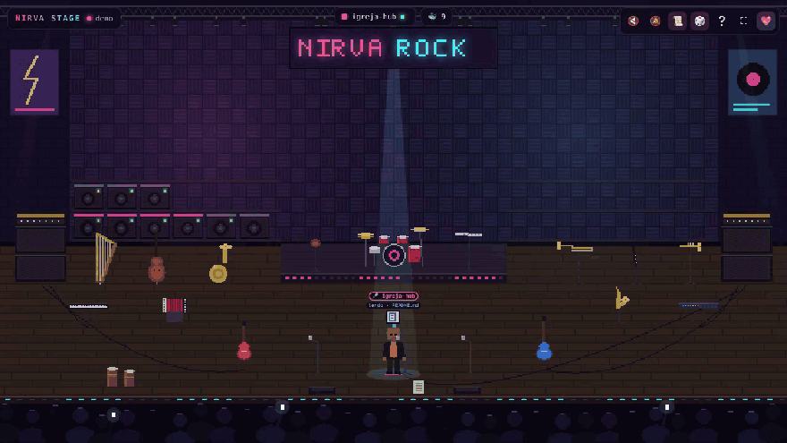

# 🎸 Nirva Stage

**Seus agentes do Claude Code como uma banda de rock em pixel art, ao vivo no navegador.**

<video src="docs/demo.mp4" controls width="100%">
  
</video>

O Nirva Stage é um **visualizador de agentes**, uma espécie de painel de observabilidade em forma de jogo.
Ele não controla o Claude Code: só observa, pelos [hooks](https://docs.claude.com/en/docs/claude-code/hooks), o que cada agente está fazendo e mostra isso no palco.

- 🎤 **Vocalistas:** o agente principal de cada sessão canta no microfone. São até 3 projetos na frente do palco, cada um com a sua cor.
- 🎻 **Orquestra rock:** cada subagente pega um instrumento livre: guitarra, baixo, bateria, teclado, synth, sax, sanfona, violino, flauta, violoncelo, harpa, trompete, trombone, clarinete, tuba e percussão.
- 🔊 **Containers Docker** de pé viram amplificadores na parede, na cor do projeto, com LED de status.
- 🚦 **Estados claros:** lendo, escrevendo, terminal, web, MCP, esperando permissão (luz âmbar piscando, som e notificação) e fim do turno (confete e plateia pulando).
- 🔒 **100% local:** nada sai da sua máquina, e o palco nunca recebe conteúdo de arquivos nem o texto dos seus prompts.

> **Teste sem instalar nada:** abra o palco com `?demo` no fim do endereço (`http://localhost:4321/?demo`) para ver eventos simulados.

---

## 🚀 Instalação

### Opção A: Docker (não precisa de Node na máquina)

**Windows (PowerShell)**

```powershell
# 1. sobe o palco (porta publicada só em 127.0.0.1)
docker run -d --name nirva-stage --restart unless-stopped -p 127.0.0.1:4321:4321 ghcr.io/oscarcasagrande/nirva-stage:latest

# 2. instala os hooks HTTP no seu Claude Code (faz backup antes)
docker run --rm -v "$env:USERPROFILE\.claude:/claude" ghcr.io/oscarcasagrande/nirva-stage node install-hooks.js --http --settings /claude/settings.json
```

**macOS / Linux (bash/zsh)**

```bash
docker run -d --name nirva-stage --restart unless-stopped -p 127.0.0.1:4321:4321 ghcr.io/oscarcasagrande/nirva-stage:latest
docker run --rm --user "$(id -u):$(id -g)" -v "$HOME/.claude:/claude" ghcr.io/oscarcasagrande/nirva-stage node install-hooks.js --http --settings /claude/settings.json
```

> Rode só o bloco do seu sistema. O `--settings /claude/...` é um caminho **dentro do container**: não rode o `install-hooks.js` com essa opção fora do Docker.

Abra **http://localhost:4321** e inicie uma sessão **nova** do `claude`.

**Para ver os containers na parede**, use o `docker-compose.yml` do repositório:

```bash
git clone https://github.com/oscarcasagrande/nirva-stage && cd nirva-stage
docker compose up -d
```

Ele monta o socket do Docker como somente leitura, e o palco só chama `GET /containers/json`.
Saiba que quem acessa o socket do Docker tem, na prática, poder de administrador no Docker. Se não quiser isso, apague o volume no compose.

### Opção B: Node.js 18+ (nativo)

```bash
git clone https://github.com/oscarcasagrande/nirva-stage && cd nirva-stage
npm run install-hooks   # hook de comando, faz backup do settings.json
npm start               # abre http://localhost:4321
```

No modo nativo, os containers aparecem pelo comando `docker ps` (se o Docker estiver instalado). Não precisa de configuração.

> **Comando ou HTTP?** O hook de comando (opção B) é silencioso: com o palco desligado, o Claude Code nem percebe.
> O hook HTTP (opção A) dispensa Node. Se o palco estiver desligado, o Claude Code pode mostrar um aviso de hook com falha, mas continua normal.

### Opção C: modo transcript (quando a empresa bloqueia hooks)

Algumas organizações liberam só os hooks definidos por elas. Nesses casos, o `/hooks` do Claude Code mostra **"managed hooks only"** e os hooks do Nirva Stage são ignorados.
No modo transcript, o palco **não usa hooks**: ele lê, só para leitura, o histórico que o Claude Code grava em `~/.claude/projects/`.

```powershell
# Node (nativo)
npm run start:transcripts

# Docker (monta ~/.claude/projects como somente leitura)
docker compose -f docker-compose.yml -f docker-compose.transcripts.yml up -d
```

Ligado assim, o palco mostra **"ao vivo · transcript"** e ignora os eventos dos hooks, para não contar nada duas vezes.

**Limitações em relação aos hooks:**

- Os eventos chegam com cerca de 1 s de atraso.
- O pedido de permissão (luz âmbar) não aparece, porque não fica registrado no histórico.
- Ao ligar, só sobem ao palco as sessões mexidas nos últimos 15 minutos. O palco não reprisa o histórico antigo.

> Os arquivos de histórico têm o conteúdo das suas conversas. O Nirva Stage lê esses arquivos só no servidor local e manda para o palco apenas o resumo de sempre: nome da ferramenta e nome do arquivo.
> Em máquina corporativa, confirme se isso está de acordo com a política da sua empresa.

### Algo não funciona?

```bash
npm run doctor              # palco, hooks, bloqueios e um evento de teste
npm run doctor -- --claude  # também roda o Claude Code de verdade e conta os eventos que chegaram
```

### Desinstalar

```bash
npm run uninstall-hooks
# ou, no Docker:
docker run --rm -v "$env:USERPROFILE\.claude:/claude" ghcr.io/oscarcasagrande/nirva-stage node install-hooks.js --uninstall --settings /claude/settings.json   # Windows
```

Isso remove só as entradas do Nirva Stage e mantém seus outros hooks. Os backups ficam em `~/.claude/settings.json.nirva-backup-*`.

---

## 🎼 O que cada coisa significa

| No palco | Evento do Claude Code |
|---|---|
| Vocalista sobe ao palco | `SessionStart` |
| Vocalista canta | `UserPromptSubmit` |
| Toca leve, olhando a partitura (azul) | `Read`, `Grep`, `Glob` |
| Solo com notas voando (rosa) | `Edit`, `Write` |
| Headbang (laranja) | `Bash` |
| Web (verde) | `WebSearch`, `WebFetch` |
| Faíscas (roxo) | ferramentas `mcp__*` |
| Músico entra / sai | `SubagentStart` / `SubagentStop` |
| Mão levantada, luz âmbar piscando, *ding* | `PermissionRequest`, `Notification` |
| Reverência, confete, plateia, acorde | `Stop` (sua vez) |
| Faísca vermelha | `PostToolUseFailure` |
| Cochilando | 5 min sem eventos |

**Quem toca o quê:**

| Tipo de agente | Instrumentos preferidos |
|---|---|
| `Explore` | guitarra, violino, flauta |
| `Plan` e arquitetos | teclado, harpa, violoncelo |
| QA e review | baixo, violoncelo, trombone |
| dev e `general-purpose` | bateria, sax |
| quem escreve documentação | sanfona, clarinete |
| PM e analistas | trompete, tuba |

Se os preferidos estiverem ocupados, o agente pega qualquer instrumento livre. Sem lugar, espera na coxia.

**Containers:** a cor vem do projeto do Docker Compose (`com.docker.compose.project`, que por padrão é o nome da pasta). Se bater com a pasta de uma sessão do Claude, o amplificador pega a cor dela.
O LED fica verde rodando, amarelo com healthcheck iniciando, vermelho com `unhealthy`, âmbar reiniciando e azul pausado. Passe o mouse para ver os detalhes.

**Atalhos:** `S` som · `N` notificações · `L` registro · `D` demo · `F` tela cheia · `H` legenda · clique num projeto no topo para destacá-lo.

---

## 🔒 Segurança e privacidade

- O palco escuta só em `127.0.0.1` (no Docker, a porta é publicada só em `127.0.0.1` do host) e recusa POSTs vindos de outras origens no navegador.
- O palco só guarda e mostra um **resumo** do evento: nome do arquivo (sem o caminho), primeira palavra do comando (ou a descrição dele), host da URL e nome da ferramenta.
  No modo HTTP, o resumo é feito no servidor, assim que o evento chega, e o resto é descartado na hora.
- O `/event` sempre responde `200`, então o palco nunca bloqueia uma ação do Claude Code.
- Sem dependências npm. A única biblioteca externa é o gerador de QR Code (`public/vendor/qrcode.js`, MIT).

## ⚙️ Configuração

| Variável | Padrão | O que faz |
|---|---|---|
| `NIRVA_PORT` | `4321` | porta do palco (use a mesma ao instalar os hooks) |
| `NIRVA_HOST` | `127.0.0.1` (`0.0.0.0` na imagem Docker) | interface em que o servidor escuta |
| `NIRVA_DOCKER` | `1` | `0` desliga os amplificadores |
| `DOCKER_SOCK` | `/var/run/docker.sock` | socket do Docker no modo container |
| `NIRVA_TRANSCRIPTS` | desligado | `1` liga o modo transcript em `~/.claude/projects`; também aceita outro caminho |
| `NIRVA_DEBUG` | desligado | `1` mostra no log os tipos de linha lidos dos transcripts |

O visual fica em `public/index.html`:

- `STATIONS`: posições do palco;
- `PREFER`: quem toca o quê;
- `ACT`: cores de cada atividade;
- `DONATE`: dados de doação (forks: coloquem os de vocês).

## ⚠️ Limitações

- Funciona com o Claude Code rodando **na sua máquina**: no terminal ou em sessões locais do app. Sessões na nuvem não alcançam o seu `localhost`.
- Quando o evento de ferramenta não traz `agent_id`, a ação aparece no vocalista em vez de no subagente.

---

## 💖 Apoie o projeto

Se o Nirva Stage deixou seus agentes mais divertidos, pague uma cerveja para a banda. 🍺

- **PIX (e-mail):** `oscar.casagrande@gmail.com`
- **PayPal:** [doar via PayPal](https://www.paypal.com/donate/?business=UT8UUZPYC426W&no_recurring=0&currency_code=BRL)
- ⭐ Dar uma estrela no repositório também ajuda muito.

O botão 💖 no canto do palco também mostra o QR Code do PIX.

## 🤝 Contribuindo

Issues e PRs são bem-vindos: novos instrumentos, cenários, temas, suporte a outros agentes (Codex, Cursor…).
Para testar localmente: `npm run serve` e depois `npm run test-event`. Algo não funciona? Rode `npm run doctor` (ou `npm run doctor -- --claude` para um teste real com o Claude Code).

## 📄 Licença

[MIT](LICENSE) © 2026 Oscar Casagrande, guitarrista da **Nirva Rock** 🤘

---

### English (short)

**Nirva Stage** turns your Claude Code agents into a pixel-art rock band in the browser.

- The main agent of each session sings at a mic, and subagents grab instruments.
- Running Docker containers become amps on the wall.
- Waiting-for-permission and turn-finished states are shown with lights, sound and confetti.

It is 100% local and only shows event summaries (file names, tool names), never file contents or prompts.

To run it, use `docker compose up -d` and install the HTTP hooks with `node install-hooks.js --http`. With Node.js, use `npm run install-hooks && npm start` instead.

MIT licensed.
