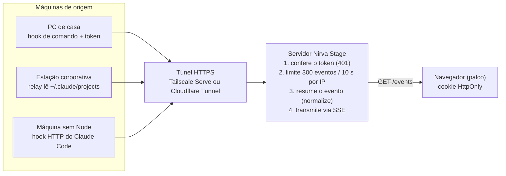

# PRD — Nirva Stage: Palco Remoto (v1.2)

Nov 6, 2026 · @Oscar

## Resumo e problema

A v1.2 do Nirva Stage passa a receber eventos de Claude Code rodando em **outras máquinas** e os mostra num palco único, protegido por token.

Hoje o palco só escuta `localhost`. Isso falha em dois casos reais:

- **Várias máquinas:** quem usa o Claude Code no notebook de casa, numa estação de trabalho e num servidor não tem uma visão única dos seus agentes.
- **Hooks bloqueados:** na estação corporativa (organização com *managed settings*), o `/hooks` mostra "managed hooks only" e os hooks de usuário são ignorados. O modo transcript (v1.1) resolve localmente, mas não leva os eventos para outro palco.

A solução tem três partes: autenticação por token no servidor, envio remoto pelos hooks e um repetidor (*relay*) que lê os transcripts da máquina de origem e envia ao palco remoto.

## Objetivos e não-objetivos

**Objetivos**

1. Um palco recebe eventos de N máquinas e mostra de onde vem cada sessão (`projeto @máquina`).
2. Funciona em máquina com hooks permitidos (hook de comando ou HTTP) e com hooks bloqueados (relay via transcripts).
3. Nada entra sem token: enviar eventos, abrir a página e baixar arquivos estáticos.
4. Nenhuma porta aberta no roteador: o acesso remoto passa por Tailscale Serve ou Cloudflare Tunnel.
5. Zero dependências npm novas e compatibilidade total com a v1.1 quando `NIRVA_TOKEN` não está definido.

**Não-objetivos (v1.2)**

- Contas de usuário, perfis ou permissões por pessoa (um token por palco basta).
- Persistência em banco: o histórico continua em memória (500 eventos, 2 h).
- Sessões do Claude Code na nuvem (web/remote), que exigiriam hook versionado no repositório com segredo.
- Detectar pedido de permissão no modo relay (não fica registrado no transcript).
- Serviço hospedado pela Nirva: cada pessoa roda o próprio palco.

## Personas e cenários

A persona principal é um dev ou líder técnico que usa o Claude Code em mais de uma máquina e quer um único painel lúdico dos agentes.

| Cenário | Máquina de origem | Hooks | Como envia | Como chega ao palco |
| --- | --- | --- | --- | --- |
| C1. Casa + notebook | PC pessoal | permitidos | hook de comando (`hook.js --url --token`) | Tailscale Serve |
| C2. Estação corporativa | Windows da empresa, conta Enterprise | bloqueados (managed hooks only) | relay lendo `~/.claude/projects` | Tailscale ou Cloudflare Tunnel |
| C3. Máquina sem Node | qualquer | permitidos | hook HTTP do Claude Code (`--http`) | Tailscale ou Cloudflare Tunnel |
| C4. Servidor ou VM de build | Linux headless | permitidos ou não | relay em Docker | Cloudflare Tunnel |

No C2 há uma restrição de governança: nomes de projetos e de arquivos saem da máquina corporativa. O README deve deixar isso explícito, e o relay nunca deve ser ligado por padrão.

## Requisitos funcionais

| ID | Requisito | Prioridade |
| --- | --- | --- |
| RF01 | Com `NIRVA_TOKEN` definido, `POST /event`, `GET /events`, `GET /` e arquivos estáticos exigem o token; `/health` responde só `{ok, auth:"required"}` sem token. | Must |
| RF02 | O token é aceito em `Authorization: Bearer`, em `?token=` ou no cookie `nirva_token`. | Must |
| RF03 | `GET /?token=<certo>` grava cookie `HttpOnly; SameSite=Lax; Max-Age=30d` (+`Secure` atrás de HTTPS) e redireciona (302) para a URL sem o token. | Must |
| RF04 | Sem token válido, `GET /` mostra uma página de login mínima; as demais rotas respondem `401`. | Must |
| RF05 | `npm run token` gera um token aleatório de 192 bits em base64url. | Must |
| RF06 | `hook.js` aceita `--url` e `--token` (ou `NIRVA_URL` e `NIRVA_TOKEN`), suporta HTTPS e anexa `host = os.hostname()` ao evento. | Must |
| RF07 | `install-hooks.js` aceita `--url` e `--token` para hooks de comando e HTTP; no HTTP grava `src`, `host` e `token` na query; mascara o token na saída. | Must |
| RF08 | O servidor lê `?host=` do POST e grava em `ev.host` quando o evento não trouxer o campo. | Must |
| RF09 | `npm run relay -- --url --token [--dir] [--host]` lê os transcripts locais e envia eventos normalizados ao palco remoto, com fila de até 1.000 eventos e nova tentativa a cada 2 s. | Must |
| RF10 | O relay para e avisa ao receber `401`; avisa quando o destino é HTTP fora do localhost. | Must |
| RF11 | Quando há sessões de mais de uma máquina, rótulos, chips, registro e notificações mostram `projeto @máquina`. | Should |
| RF12 | `docker-compose.remote.yml` exige `NIRVA_TOKEN` e mantém a porta só em `127.0.0.1`. | Should |
| RF13 | O relay roda em Docker com o diretório de transcripts montado como somente leitura. | Should |
| RF14 | `npm run doctor` aceita `NIRVA_TOKEN` e avisa quando o palco exige token. | Should |
| RF15 | No modo transcript, eventos vindos de hooks locais (`src=nirva-stage`) são ignorados; os do relay (`src=nirva-relay`) não. | Must |

## Segurança e requisitos não funcionais

**Segurança**

| ID | Requisito |
| --- | --- |
| RS01 | O servidor se recusa a iniciar com `NIRVA_HOST` fora do loopback e sem `NIRVA_TOKEN`, exceto com `NIRVA_IN_DOCKER=1` (porta publicada só em 127.0.0.1) ou `NIRVA_INSECURE=1`. |
| RS02 | O token vale também para requisições de 127.0.0.1, porque Tailscale Serve e Cloudflare Tunnel chegam como loopback. |
| RS03 | A comparação do token é em tempo constante: `crypto.timingSafeEqual` sobre os SHA-256 dos dois valores. |
| RS04 | A recusa de autenticação em `/event` responde `401`, nunca `403`, porque para hooks HTTP o `403` pode significar "bloquear a ação". |
| RS05 | Limite de 300 POSTs por IP a cada 10 s; acima disso, `429`. |
| RS06 | Continua valendo a regra da v1.0: só o resumo do evento sai da máquina de origem (ferramenta, nome do arquivo, primeira palavra do comando, host da URL), nunca conteúdo, prompts ou saídas. |
| RS07 | O token nunca aparece em log, na saída do instalador ou na URL depois do login. |
| RS08 | Requisições de navegador com `Origin` estranho em `POST /event` são recusadas. |

**Não funcionais**

- **Desempenho:** o hook termina em até 1,5 s e sempre com código 0. O relay entrega o evento ao palco em menos de 2 s em rede normal.
- **Resiliência:** com o palco fora do ar, o relay guarda até 1.000 eventos e reenvia; o hook simplesmente desiste.
- **Compatibilidade:** sem `NIRVA_TOKEN`, o comportamento é idêntico ao da v1.1. Node 18+, Windows, macOS e Linux.
- **Dependências:** nenhuma dependência npm nova.

## Arquitetura e contratos



As três origens mandam o mesmo evento resumido pelo túnel HTTPS. O servidor confere o token antes de qualquer outra coisa, e a porta 4321 continua publicada só em 127.0.0.1.

**Endpoints**

| Rota | Método | Auth | Resposta |
| --- | --- | --- | --- |
| `/event` | POST | token (header, query ou cookie) | sempre `200 {}`; `401` sem token; `429` acima do limite |
| `/events` | GET (SSE) | token | eventos `mode`, `replay`, `docker` e dados |
| `/` | GET | token ou cookie | palco; sem token, página de login; `?token=` grava cookie + 302 |
| `/vendor/qrcode.js` | GET | token ou cookie | arquivo estático |
| `/health` | GET | pública | `{ok, auth:"required"}` sem token; detalhes com token |

**Evento normalizado (v1)**

```json
{ "v": 1, "event": "PreToolUse", "session": "f86c66d2-...", "agent": "a1b2c3", "agentType": "Explore",
  "tool": "Grep", "detail": "TODO", "project": "mini-document-management",
  "note": "", "ntype": "", "host": "estacao-srm", "ts": 1793979245947 }
```

O campo novo da v1.2 é `host` (até 32 caracteres). O servidor revalida e corta todos os campos (`sanitize`) e sobrescreve `ts`.

**Configuração**

| Variável | Padrão | Uso |
| --- | --- | --- |
| `NIRVA_TOKEN` | vazio | liga a autenticação |
| `NIRVA_HOST` | `127.0.0.1` | interface de escuta; fora do loopback exige token |
| `NIRVA_URL` | `http://127.0.0.1:4321/event` | destino do `hook.js` e do relay |
| `NIRVA_INSECURE` | vazio | `1` permite expor sem token (não recomendado) |

Arquivos: `server.js`, `hook.js`, `install-hooks.js`, `scripts/relay.js`, `scripts/token.js`, `lib/normalize.js` (campo `host`), `docker-compose.remote.yml`, `public/index.html` (`projName`).

## Épicos e histórias

São quatro épicos, em ordem de dependência: E1 destrava todos os outros.

### E1. Autenticação do palco

- [ ] **1.1 Token no servidor.** Como dono do palco, quero exigir um token para que ninguém na rede envie ou veja eventos.
    - Dado `NIRVA_TOKEN`, quando faltar ou estiver errado o token em `/event`, `/events` ou arquivo estático, então a resposta é `401` (RF01, RF02, RS04).
    - A comparação usa `timingSafeEqual` sobre SHA-256 (RS03).
    - Sem `NIRVA_TOKEN`, nada muda em relação à v1.1.
- [ ] **1.2 Login no navegador.** Como usuário, quero digitar o token uma vez e o navegador lembrar.
    - `GET /` sem token mostra a página de login; com `?token=` certo grava o cookie e redireciona para `/` (RF03, RF04).
    - O token não fica na URL nem no histórico depois do redirect (RS07).
- [ ] **1.3 Guarda de exposição.** Como dono, quero que o palco se recuse a subir exposto sem token.
    - `NIRVA_HOST=0.0.0.0` sem token e sem `NIRVA_IN_DOCKER` ou `NIRVA_INSECURE` encerra com mensagem clara (RS01).
- [ ] **1.4 Limite de taxa e gerador de token.**
    - O 301º POST de um IP em 10 s recebe `429` (RS05).
    - `npm run token` imprime 32 caracteres base64url (RF05).

### E2. Envio remoto pelos hooks

- [ ] **2.1 hook.js remoto.** Como usuário com hooks permitidos, quero apontar o hook para um palco remoto.
    - `--url`/`--token` e `NIRVA_URL`/`NIRVA_TOKEN` funcionam; HTTPS funciona; `host` vai no evento (RF06).
    - Com o palco fora do ar, o hook sai com código 0 em até 1,5 s.
- [ ] **2.2 Instalador remoto.** Como usuário, quero instalar com `--url` e `--token`.
    - O hook de comando recebe os argumentos; o hook HTTP recebe `src`, `host` e `token` na query; a saída mascara o token (RF07, RS07).
    - Reinstalar substitui as entradas antigas sem duplicar.
- [ ] **2.3 Host pela query.** O servidor preenche `host` a partir de `?host=` quando o evento não traz (RF08).

### E3. Relay para máquinas com hooks bloqueados

- [ ] **3.1 Relay básico.** Como usuário numa estação com managed hooks, quero que meus agentes apareçam no palco de casa.
    - `npm run relay -- --url --token` lê `~/.claude/projects` com `lib/transcripts.js` e envia com `src=nirva-relay` (RF09, RF15).
    - Nenhum trecho de prompt, conteúdo de arquivo ou argumento de comando sai da máquina (RS06).
- [ ] **3.2 Resiliência.** Com o palco fora do ar, fila de até 1.000 eventos e nova tentativa a cada 2 s; com `401`, para e avisa; com HTTP fora do localhost, avisa (RF10).
- [ ] **3.3 Relay em Docker.** `docker run` com `~/.claude/projects` montado como somente leitura e `--host $COMPUTERNAME` (RF13).

### E4. Palco multi-máquina e operação

- [ ] **4.1 Rótulo por máquina.** Com sessões de duas ou mais máquinas, vocalista, chip, registro e notificação mostram `projeto @máquina`; com uma máquina só, nada muda (RF11).
- [ ] **4.2 Compose remoto.** `docker-compose.remote.yml` falha sem `NIRVA_TOKEN` e mantém `127.0.0.1:4321` (RF12).
- [ ] **4.3 Doctor com token.** `npm run doctor` usa `NIRVA_TOKEN` e explica quando o palco pede token (RF14).
- [ ] **4.4 Documentação.** README com Tailscale Serve, Cloudflare Tunnel, relay e o aviso de governança para máquinas corporativas.

## Plano de testes e definição de pronto

| # | Teste | Resultado esperado |
| --- | --- | --- |
| T01 | `NIRVA_HOST=0.0.0.0` sem token | processo encerra com a mensagem da RS01 |
| T02 | sem token: `GET /`, `/events`, `POST /event`, `/vendor/qrcode.js` | login `200`, depois `401` nos outros três |
| T03 | token errado em `POST /event` | `401` |
| T04 | `GET /?token=<certo>` | `302` para `/` + `Set-Cookie: nirva_token=…; HttpOnly; SameSite=Lax` |
| T05 | `/events` e estáticos com o cookie | `200` |
| T06 | `hook.js --url --token` para outro IP | evento chega com `host` da máquina |
| T07 | hook HTTP com `?token=&host=` | `200`, evento com o `host` da query |
| T08 | 320 POSTs de um IP em menos de 10 s | 300 × `200`, 20 × `429` |
| T09 | relay com transcripts simulados (prompt, Read, subagente Explore, Bash com falha, fim de turno) | 13 eventos na ordem, todos com `@host`, subagente com tipo correto |
| T10 | grep por trechos sensíveis (texto do prompt, conteúdo lido, `--token=XYZ` no comando) no fluxo SSE | 0 ocorrências |
| T11 | relay com token errado | mensagem "O palco recusou o token (401)" e fila descartada |
| T12 | duas máquinas no palco | rótulos `projeto @máquina`; com uma máquina, sem `@` |
| T13 | sem `NIRVA_TOKEN` | todos os testes da v1.1 passam sem mudança |
| T14 | Windows real + Tailscale Serve + relay na estação corporativa | vocalista da estação aparece no palco de casa em menos de 2 s |

**Pronto quando:** T01 a T13 passam em CI (Ubuntu, Node 22), T14 foi feito manualmente uma vez, o README está atualizado e a imagem `ghcr.io/oscarcasagrande/nirva-stage:1.2.0` foi publicada.

## Riscos, dependências e questões em aberto

| Risco | Impacto | Mitigação |
| --- | --- | --- |
| Política corporativa proíbe enviar metadados para fora (nomes de projeto e de arquivo) | alto: uso do relay vetado na SRM | relay desligado por padrão, aviso no README, opção de palco só local no modo transcript |
| Formato dos transcripts muda (não é documentado pela Anthropic) | médio: relay deixa de ver ações | parser defensivo, `NIRVA_DEBUG=1` lista os tipos de linha vistos, teste T09 com fixture |
| Token vaza (settings.json, histórico do shell) | médio: terceiros veem nomes de arquivos | `npm run token` para trocar rápido, máscara na saída, recomendação de Tailscale (rede privada) |
| Hook HTTP com palco desligado gera aviso no Claude Code | baixo: ruído na sessão | preferir hook de comando; o palco sempre responde `200` |
| Proxy corporativo bloqueia Tailscale ou Cloudflare | médio: C2 não funciona | documentar o teste T14 e a alternativa de palco local |

**Dependências:** Node 18+ ou Docker na origem; Tailscale ou cloudflared na máquina do palco; modo transcript da v1.1 (`lib/transcripts.js`).

**Questões em aberto**

- [ ] A política de segurança da SRM permite o relay na estação? Quem aprova?
- [ ] Um token por palco basta ou precisamos de um token por máquina, para revogar uma só?
- [ ] O hook HTTP do Claude Code aceita cabeçalho com variável de ambiente? Se sim, o token sai da query.
- [ ] Vale suportar sessões do Claude Code na nuvem numa v1.3?

## Métricas de sucesso e plano de entrega

**Métricas**

- Latência ponta a ponta (ação do Claude até o palco): até 1 s com hook e até 2 s com relay.
- Zero ocorrências de conteúdo sensível no fluxo SSE (T10) em toda versão publicada.
- Zero acessos aceitos sem token nos testes T02 e T03.
- Duas ou mais máquinas no mesmo palco por pelo menos uma semana de uso real, sem eventos perdidos visíveis.

**Entrega, em ordem**

1. **E1: autenticação.** Sem ela nada pode ser exposto. Sai com T01 a T05 e T08.
2. **E2: hooks remotos.** Usa o E1 e cobre os cenários C1 e C3. Sai com T06 e T07.
3. **E3: relay.** Usa E1 e o modo transcript, e cobre C2 e C4. Sai com T09 a T11.
4. **E4: palco multi-máquina, compose, doctor e README.** Sai com T12 e T13; depois, o T14 manual.
5. **Release 1.2.0:** tag `v1.2.0`, imagem no GHCR, changelog no README.

**Para construir no Claude Code**, salve este PRD em `docs/prd-palco-remoto.md` e comece com:

```text
Leia docs/prd-palco-remoto.md. Implemente o épico E1 inteiro, história por história, sem dependências npm novas.
Para cada história: escreva o teste da tabela de testes primeiro, depois o código, e rode os testes da v1.1.
Pare ao fim do E1 e me mostre o diff e o resultado dos testes.
```
